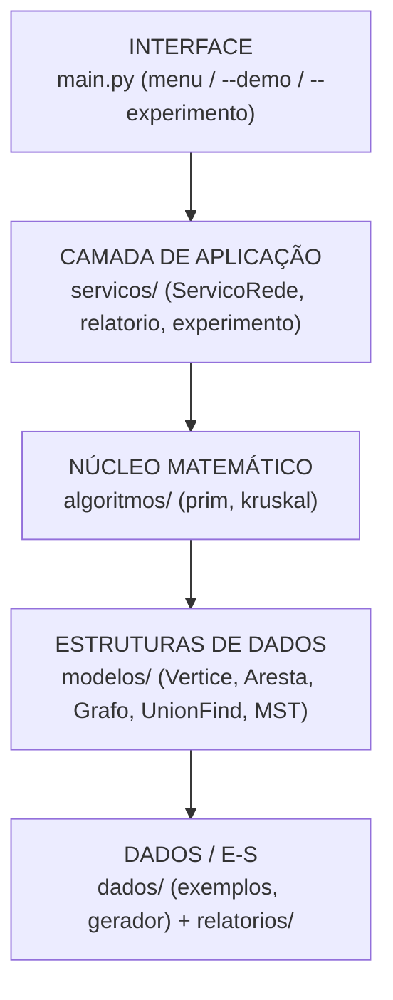
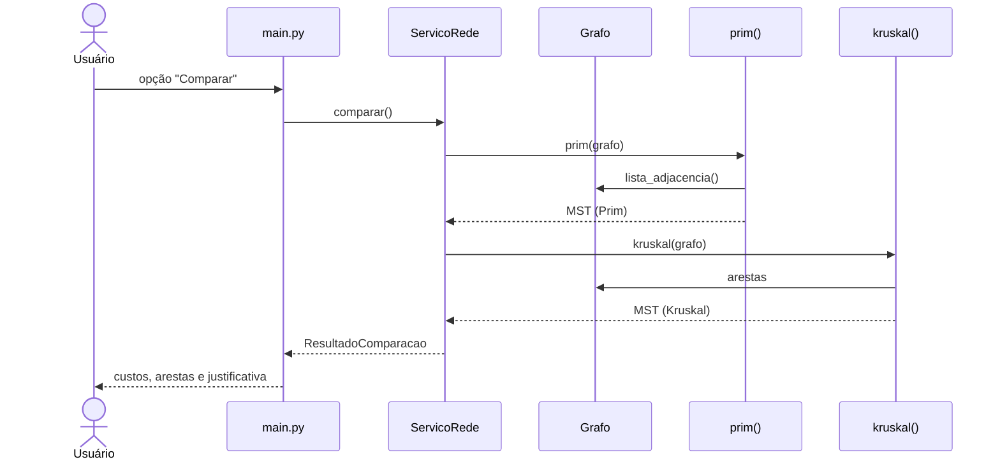

# 04 - Arquitetura

## Camadas (padrão UrbanTech)

## Fluxo de uma comparação (RF07)

## Estrutura de pastas
| Pasta | Conteúdo |
|---|---|
| `src/modelos/` | entidades do domínio: `Vertice`, `Aresta`, `Grafo`, `UnionFind`, `MST` |
| `src/algoritmos/` | somente o núcleo matemático: `prim.py`, `kruskal.py` |
| `src/servicos/` | casos de uso: `servico_rede.py`, `relatorio.py`, `experimento.py` |
| `src/dados/` | redes de exemplo e gerador de redes sintéticas |
| `src/utilitarios/` | exceções, formatação em reais e visualização |
| `tests/` | testes automatizados |
| `docs/` | documentação |
| `relatorios/` | CSV de complexidade, profiling e figuras |

(Equivalência com o modelo do documento UrbanTech: models→modelos, algorithms→algoritmos,
services→servicos, data→dados, utils→utilitarios.)

## Decisões de projeto
- Os vértices são identificados por **nome** (texto), simples de cadastrar e de ler nos relatórios.
- Arestas duplicadas: mantém-se a de **menor custo** (A–B e B–A são a mesma conexão).
- Desempate determinístico `(custo, origem, destino)` para resultados reprodutíveis.
- Prim usa o primeiro ponto cadastrado como início, salvo se outro for informado.
